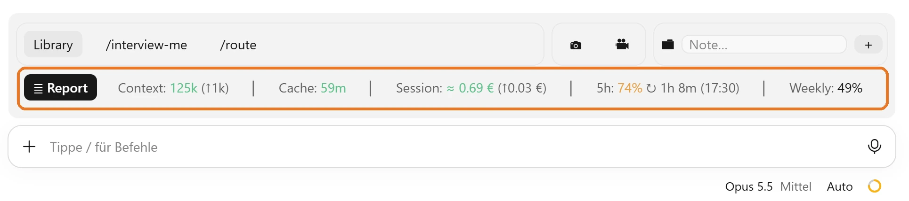
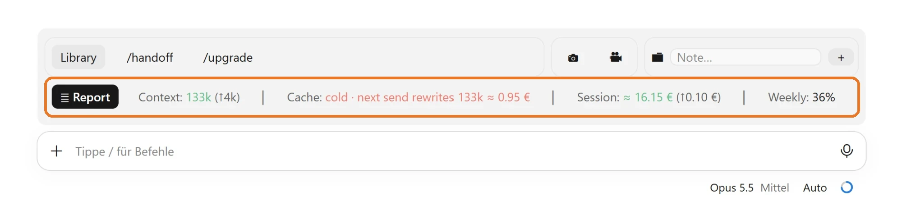
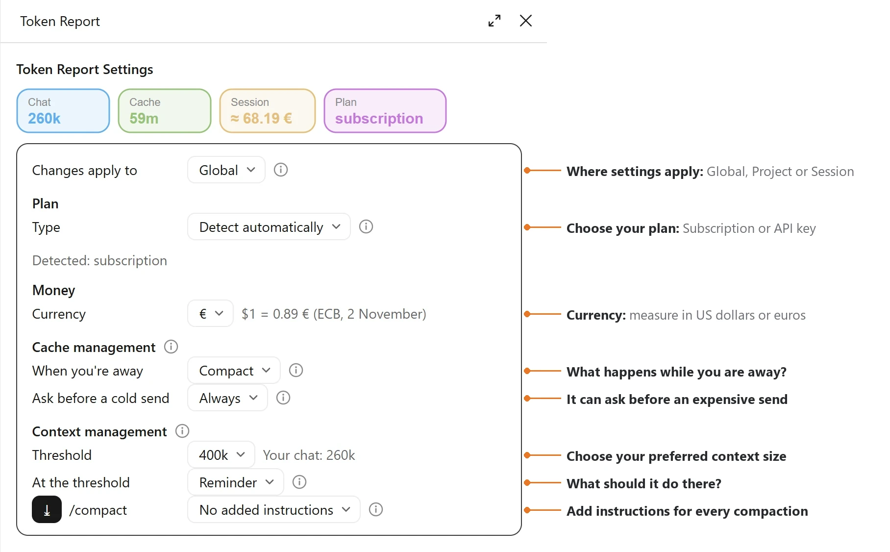
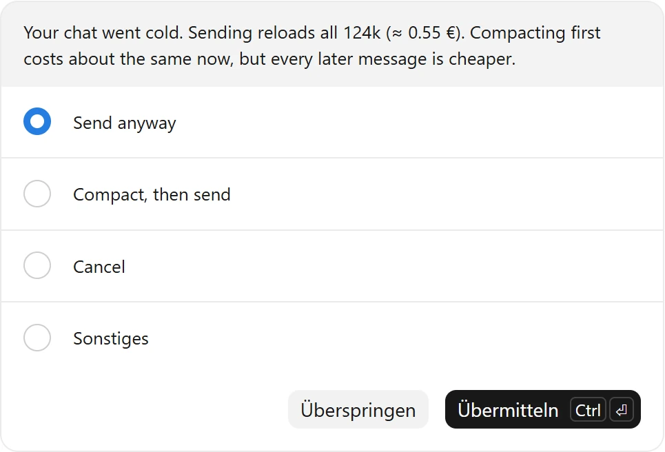

# Token Report



| Pain point | What Token Report does |
|---|---|
| **Cache.** A long chat is cheap while its cache is warm and expensive once it goes cold. Claude Code does not show when that happens. | The band counts down the minutes until the cache goes cold. Before an expensive send on a cold cache, a dialog asks first. While you are away, it keeps the cache warm or compacts, as you choose. |
| **Context.** The chat grows quietly until Claude Code compacts it at its own limit. | The band shows the chat's size and how much the last turn added. At your threshold it reminds you, asks or compacts. |
| **Cost.** You don't see what a session costs, or how much of your plan is left. | The band shows the session's cost (at API prices on a subscription) and your 5-hour and weekly limits. |

## The band

- **Context** in tokens, with the growth of the last turn. It turns orange and then red as it nears your threshold.
- **Cache**: minutes until the cache goes cold. Cold means the next message re-reads the whole chat at the write price.
- **Session** cost. On a subscription this is what the session would cost at API prices.
- **Plan limits** (5 hours and weekly) with their reset time, on a subscription.
- **⤓** compacts the chat now, while the cache is warm.

Once the cache has gone cold, the band says what the next send costs:



## Settings

**≣ Report** on the band, or `/tokens`, opens the Settings pane. The four cards on top show the chat's size, the cache, the session's cost and your plan. Below them, the settings in four groups: Plan, Money, Cache management and Context management.



Settings apply to:

1. **Global**: every session.
2. **Project**: a `.token-report/settings.json` in the project folder, for everyone who opens that folder.
3. **Session**: this chat only.

### When you're away

Two questions, four choices:

| | Compact the chat | Keep the full chat |
|---|---|---|
| **Let the cache go cold** | **Compact** | **Keep full** (default) |
| **Keep the cache warm first** | **Cache Warmer, then compact** | **Cache Warmer, then keep full** |

- **Compact.** Claude Code compacts idle chats itself from its idle threshold on (200k by default). Below that threshold, Token Report compacts once per pause, 10 minutes before a 1-hour cache goes cold, for chats of 50k and more. On a 5-minute cache it does nothing. One compaction reads the chat while it is still warm and writes a summary.
- **Keep full** (default). Nothing compacts while you are away. Claude Code's own idle summary is refused as well, and the full chat stays. Out of the box the mod spends no tokens on its own.
- **Cache Warmer.** A short request reads the chat a few minutes before the cache would expire, for a set time after your last message: 1, 2 or 5 hours on a 1-hour cache, or 15, 30 or 45 minutes on a 5-minute cache. Each ping costs a cache read of the chat. Then it compacts or keeps the full chat, as chosen.

### Other settings

| Setting | Choices | Default |
|---|---|---|
| Plan type | Detect automatically, Subscription, API key | Detect |
| Currency | $, € | $ |
| Ask before a cold send | Never, Above 0.25, Above 0.50, Above 1.00, Always | Above 0.50 |
| Threshold | 200k, 300k, 400k, 600k, Max, Custom (50k at least) | 400k |
| At the threshold | Off, Reminder, Ask, Compact | Reminder |
| /compact | No added instructions, Added instructions | None |

- **Ask before a cold send.** If the cache has gone cold and your message would cost more than the amount you set, a dialog asks first. Its choices are **Send anyway**, **Compact, then send** (your message goes again on the small chat), or **Cancel**. Closing the dialog cancels. If Claude Code already wrote an idle summary, the middle choice is **Use the summary**.

  

- **At the threshold.** The Reminder and Ask come back every further 100k.
- **/compact instructions** go with every compaction the mod starts and with Claude Code's idle summary.

Claude Code's own switches still apply. `CLAUDE_CODE_IDLE_COMPACT_MIN_TOKENS` sets the idle threshold (minimum 100k), and the mod reads it. `"idleCompaction": false` in Claude Code's settings turns idle compaction off. `"promptCacheTtl": "5m"` or `"1h"` sets the cache lifetime.

## What it costs

Watching costs nothing. The band reads usage that Claude Code already has and changes nothing Claude reads. Tokens are spent only:

- by a compaction: **Compact** while you are away, **Compact** at the threshold, **⤓**, or **Compact, then send**
- by Cache Warmer pings, if you choose a Cache Warmer. On a 150k chat with Opus, a ping costs about $0.06 at API prices.

## Install

Token Report is a mod for the Code tab of the Claude desktop app, built and tested there (Claude Code 2.1.309). The terminal is untested.

In the desktop app: click **+** next to the prompt box, then **Plugins**, **Add marketplace** with `byMarcoVogt/mods`, then **Add plugin** and pick `token-report`.

From a terminal session:

```
/plugin install token-report --marketplace byMarcoVogt/mods
```

Answer `y` to add the marketplace, then pick the user scope. The band shows up in the next session. `/tokens` opens the Settings pane, and so does **≣ Report** on the band.

**Update:** `/plugin marketplace update bymarcovogt-mods`. **Uninstall:** `/plugin uninstall token-report`.

## License

[MIT](LICENSE)
